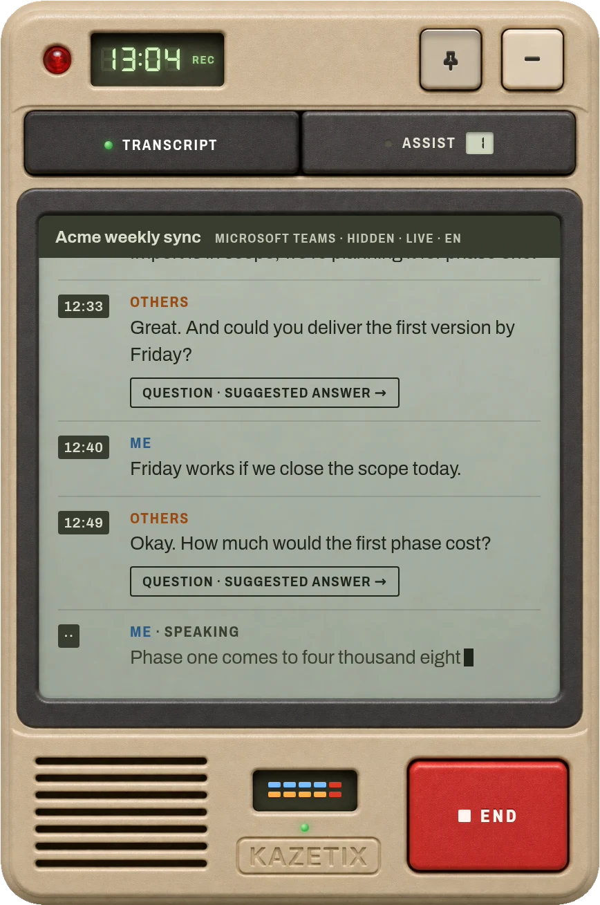
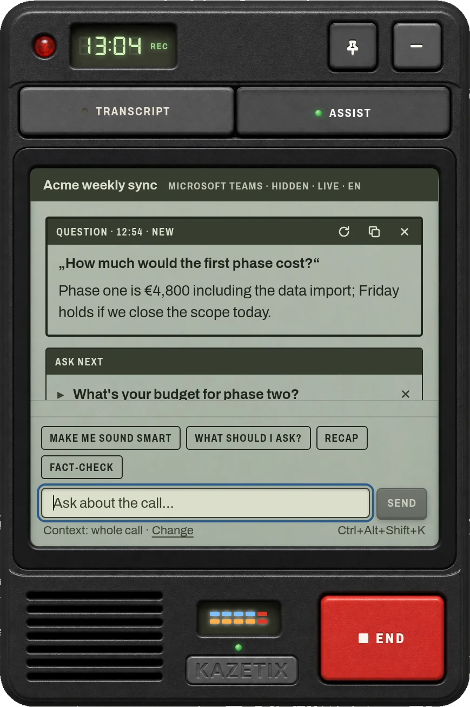
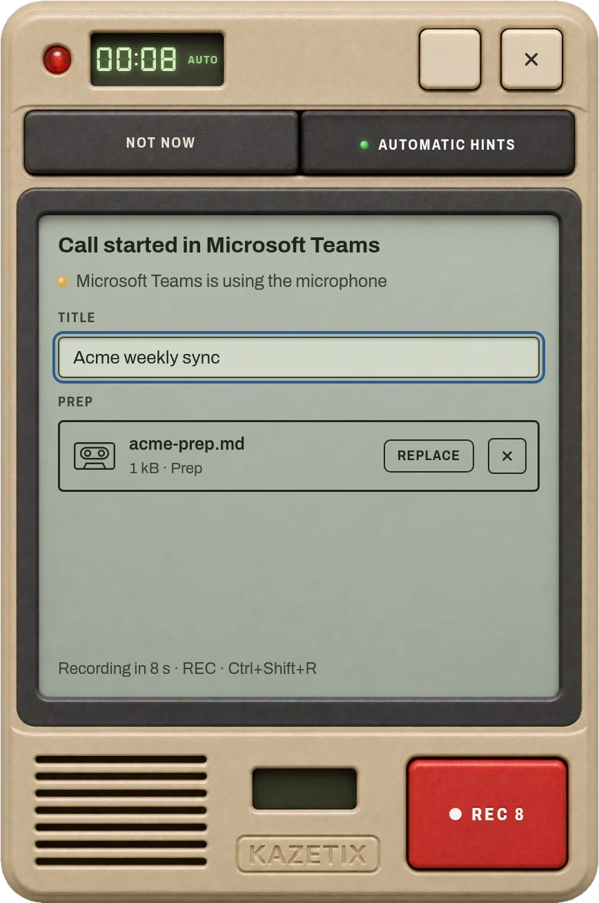
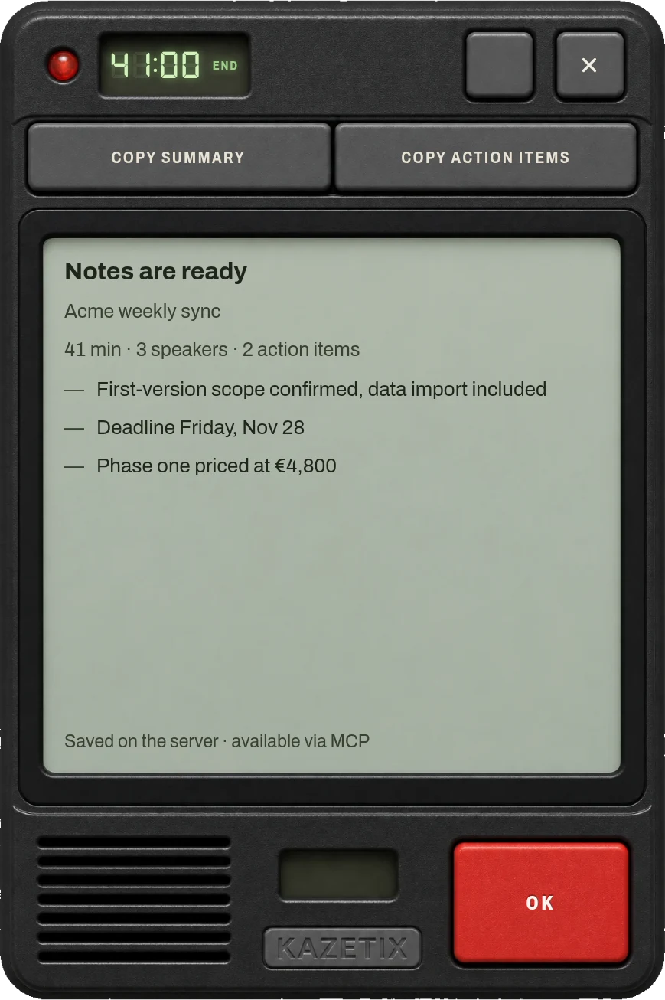
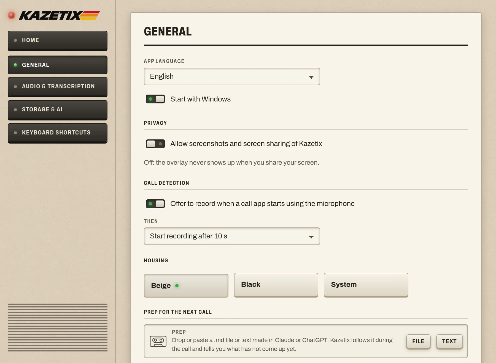

<p align="center"></p>

<p align="center"><b>Live call transcripts, in-call hints and notes after the call — a 1980s answering machine for Teams, Meet and Zoom.<br>Self-hosted, with MCP for Claude.</b></p>

<p align="center"></p>

Kazetix is a Windows desktop app that listens to your calls (your microphone and the system audio, separately),
transcribes them live, suggests what to say next, and writes up the call afterwards. Your archive stays on your machine
or on a server you run, and Claude can read it over MCP. All AI goes through one [OpenRouter](https://openrouter.ai) key.

## Features

- **Live two-channel transcript.** Microphone ("Me") and system audio ("Others") are captured and transcribed separately.
- **In-call hints.** Suggested answers and an ask-next list while the call is running, plus a chat for questions about it.
- **Prep notes.** Attach a `.md` file prepared in Claude or ChatGPT; Kazetix uses it for hints and keeps a checklist of what you planned to cover.
- **Automatic call detection.** Offers to record when a call app starts using the microphone, with an optional countdown.
- **Capsule mode.** Collapse the overlay to a small capsule while you talk.
- **Notes after the call.** Exact transcript, summary and action items once the call ends.
- **Built-in archive + MCP.** Search past calls locally and connect Claude Desktop or Claude Code to them.
- **Optional self-hosted server.** Docker or plain Node; exact transcript, summaries and an MCP endpoint for claude.ai.
- **Beige or black housing**, Czech and English UI.

The overlay is excluded from screen capture, and a local stereo Ogg/Opus backup of the call is kept (left = mic, right = system audio).

## A quick tour

| | |
|---|---|
| <br>Hints and chat in one Assist tab | <br>Capsule mode |
| <br>A call is detected | <br>Notes are ready |
| <br>Settings | |

## Install

**Requirements:** Windows 10 (2004 or newer) or Windows 11, the WebView2 runtime (built into Windows 11), and an
OpenRouter API key.

**One prompt.** Give this to Claude or ChatGPT and let it walk you through the setup:

> Install Kazetix for me by following https://github.com/Domin-Labs/kazetix/blob/main/INSTALL.md. Ask me before each step that needs my keys or my server.

**Build from source (Linux or WSL).** The app is cross-compiled to `x86_64-pc-windows-msvc` with clang-cl/lld-link
(LLVM 18+, `cmake`, `ninja`) and the MSVC CRT + Windows SDK fetched by [xwin](https://github.com/Jake-Shadle/xwin):

```bash
xwin --accept-license --arch x86_64 --variant desktop splat --output ~/.local/toolchains/xwin-sdk   # once
scripts/build-windows.sh     # UI + release exe -> apps/desktop/src-tauri/target/x86_64-pc-windows-msvc/release/kazetix.exe
scripts/install-windows.sh   # copy to %LOCALAPPDATA%\Programs\Kazetix, Start-menu shortcut, launch
```

On first start Settings opens: enter your OpenRouter key (stored in Windows Credential Manager) and, optionally, your
server address and API token. Defaults: `Ctrl+Alt+Shift+R` start/stop, `Ctrl+Alt+Shift+O` overlay,
`Ctrl+Alt+Shift+K` chat, `Ctrl+Alt+Shift+M` mark. Logs (never containing transcript text):
`%APPDATA%\cz.dpstudio.kazetix\kazetix.log`.

**Cost (OpenRouter).** Scribe v2 is $0.22 per hour of audio. Live transcription is billed only for detected speech, per
channel (at most $0.44/h with two channels); the exact transcript after the call is $0.22/h per channel. LLM usage for
hints, chat and the summary comes on top.

## Self-host the server

The server (`apps/server`, Node 24, SQLite/FTS5, ffmpeg) produces the exact transcript, summary and action items, and
serves the archive over MCP.

```bash
pnpm install
pnpm server:test          # end-to-end self-check with fake OpenRouter
cp .env.example .env      # fill in, then:
DATA_DIR=./data node --env-file=.env apps/server/src/main.ts
```

With Docker (see [`docker/docker-compose.yml`](docker/docker-compose.yml)):

```bash
cp .env.example .env && mkdir -p data && chown -R 1000:1000 data
docker compose -f docker/docker-compose.yml up -d --build
```

Put an HTTPS reverse proxy in front of `127.0.0.1:8767` (no buffering, long read timeout, body size of at least 80 MB).
`PUBLIC_BASE_URL` must be that public address, e.g. `https://kazetix.example.com`.

REST API (Bearer `KAZETIX_API_TOKEN`): `GET /api/health`, `POST /api/meetings`, `POST /api/meetings/:id/segments`,
`POST /api/meetings/:id/hints`, `POST /api/meetings/:id/marks`, `PUT /api/meetings/:id/audio` (resumable, `Content-Range`),
`POST /api/meetings/:id/finish`, `GET /api/meetings/:id`.

## Connect Claude (MCP)

Endpoint `https://kazetix.example.com/mcp` on your server. Tools: `list_meetings`, `get_meeting`, `read_transcript`,
`search`, `get_action_items`, `get_live_meeting`, `mark_exported`, `status`.

- **claude.ai:** Settings, Connectors, Add custom connector, `https://kazetix.example.com/mcp`, sign in with `KAZETIX_MCP_PASSWORD`.
- **Claude Code:** `claude mcp add --transport http kazetix https://kazetix.example.com/mcp` (sign in in the browser), or headless with `--header "Authorization: Bearer <KAZETIX_API_TOKEN>"`.

Without a server, the desktop app keeps its own archive and can register itself with Claude Desktop and Claude Code (Settings).

## Configuration (server)

| Variable | Meaning |
|---|---|
| `PUBLIC_BASE_URL` | public HTTPS URL (OAuth issuer, signed audio links) |
| `KAZETIX_API_TOKEN` | Bearer token for the desktop REST API; also accepted on `/mcp` for headless clients |
| `KAZETIX_MCP_PASSWORD` | owner password on the MCP OAuth sign-in page |
| `OPENROUTER_API_KEY` | exact transcript, summaries and action items |
| `SUMMARY_MODEL`, `STT_MODEL` | defaults `anthropic/claude-sonnet-5.5`, `elevenlabs/scribe-v2` |
| `DEFAULT_LANGUAGE` | transcript language, default `cs` |
| `DATA_DIR`, `PORT` | data folder (database + audio), default port `8767` |

## Development

```bash
pnpm install
pnpm server:test                              # server self-test
pnpm typecheck                                # all packages
pnpm desktop:dev                              # desktop UI with Vite
pnpm --filter @kazetix/desktop demo           # UI in a browser with a mocked Tauri backend
```

Layout: `apps/desktop` (Tauri 2 + React), `apps/server` (Node + TypeScript), `packages/shared` (wire types, zod schemas),
`docker/`, `scripts/`.

## License

Kazetix is released under the [Functional Source License, Version 1.1, ALv2](LICENSE). You can use, modify and self-host
it freely, including at work, but you may not sell it or a fork as a competing product or service. Each release
automatically becomes Apache-2.0 two years after it ships.
